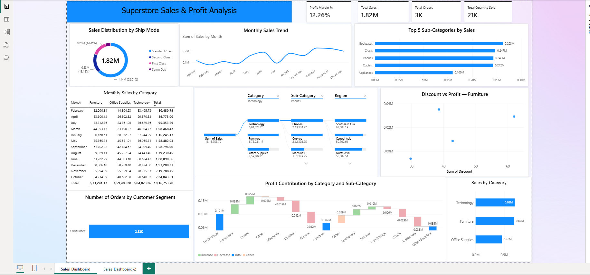

# Superstore Sales & Profit Analysis | Power BI

An interactive Power BI project focused on retail sales performance, product analysis, profitability, customer segments, shipping modes, and geographic sales distribution.

## Project Overview

The objective of this project is to analyze retail sales data and present useful business insights through an interactive Power BI report.

The report combines key performance indicators with visual analysis of sales trends, product categories, sub-categories, customer segments, profit contribution, and geographic performance.

## Dashboard Preview



## Business Objectives

- Analyze overall sales and profitability.
- Track monthly sales trends.
- Compare product categories and sub-categories.
- Explore sales distribution across shipping modes and customer segments.
- Examine the relationship between discounts and profit.
- Identify positive and negative profit contributions.
- Compare sales performance across countries and states.

## Tools & Technologies

- **Microsoft Power BI Desktop** — Dashboard development and reporting
- **Power Query** — Data preparation and transformation
- **DAX** — Measures and KPI calculations
- **Data Visualization** — Business performance analysis

## Dataset Description

The project uses retail sales data containing information about orders, products, customers, shipping, sales, and profit.

Key fields used in the analysis include:

- Order Date and Order ID
- Sales, Profit, Quantity, and Discount
- Category and Sub-Category
- Customer Name and Customer ID
- Region, State, Country, and Market
- Segment and Ship Mode

The original dataset's source and usage permissions should be checked before redistributing the raw data.

## Dashboard KPIs

The main dashboard includes:

| KPI | Purpose |
|---|---|
| Total Sales | Measures overall sales value |
| Profit Margin (%) | Shows profit as a percentage of sales |
| Total Orders | Tracks order volume |
| Total Quantity Sold | Measures total quantity sold |

KPI values depend on the report's filter context.

## Dashboard Features

### Page 1 — Sales & Profit Overview

**1. Sales Distribution by Ship Mode**

A donut chart compares sales distribution across shipping modes.

**2. Monthly Sales Trend**

A line chart displays monthly sales performance and helps identify changes over time.

**3. Top 5 Sub-Categories by Sales**

A bar chart ranks the five highest-selling sub-categories.

**4. Monthly Sales by Category**

A matrix compares monthly sales across Furniture, Office Supplies, and Technology.

**5. Sales Decomposition Tree**

An interactive decomposition tree explores sales by category, sub-category, and region.

**6. Discount vs Profit — Furniture**

A scatter chart examines the relationship between discounts and profit for Furniture products.

**7. Orders by Customer Segment**

A funnel chart compares order volume across customer segments.

**8. Profit Contribution by Category and Sub-Category**

A waterfall chart displays positive and negative profit contributions.

**9. Sales by Category**

A bar chart compares sales across the three main product categories.

### Page 2 — Product & Geographic Analysis

**1. Sales Contribution by Category & Sub-Category**

A treemap compares sales contribution across product categories and sub-categories.

**2. Top 10 States by Sales**

A horizontal bar chart ranks states or geographic areas by sales. Since the dataset contains locations from multiple countries, state names should be interpreted alongside their countries when comparing geographic performance.

**3. Top 10 Countries by Sales**

A horizontal bar chart compares sales across countries and highlights the highest-performing markets in the displayed report context.

## Key Findings

The following observations are based on the dashboard values previously reviewed. Verify them again after finalizing the report filters.

- **Category performance:** Technology has the highest displayed category sales, followed by Furniture and Office Supplies.
- **Sub-category performance:** Phones ranks first among the displayed top five sub-categories.
- **Shipping preference:** Standard Class accounts for the largest displayed share of sales.
- **Monthly trends:** Sales fluctuate across months, making trend analysis useful for understanding changes in performance.
- **Profitability:** Sales and profit should be evaluated together. The scatter and waterfall charts help identify areas that may require further investigation.
- **Geographic performance:** Country and state-level charts allow sales performance to be compared across locations.

These observations describe the displayed report and do not establish the causes of sales or profit changes.

## Business Recommendations

- Review category and sub-category performance to understand sales contribution.
- Evaluate profitability alongside revenue when comparing products.
- Investigate sub-categories with negative profit contributions.
- Examine discount levels and profitability together before making pricing decisions.
- Use monthly sales trends to support sales and inventory planning.
- Compare geographic performance while accounting for differences between countries and states.
- Evaluate shipping preferences alongside shipping costs and customer requirements.

These recommendations identify areas for further analysis rather than proven business outcomes.

## Data Preparation & Cleaning

Data preparation is an important part of building a reliable Power BI report.

The preparation process should document the transformations actually performed, including relevant checks such as:

- Reviewing column names and data types.
- Checking date and numeric fields.
- Reviewing missing values and duplicates where appropriate.
- Assessing the relevance of identifier fields.
- Confirming that Sales, Profit, Discount, and Quantity are suitable for analysis.
- Validating DAX measures and report totals.

The exact cleaning steps should be documented based on the actual Power Query workflow. Null values and duplicate records should not be removed automatically without checking their meaning.

## DAX Measure

### Profit Margin %

```dax
Profit Margin % =
DIVIDE(
    SUM('RetailVista_Sales'[Profit]),
    SUM('RetailVista_Sales'[Sales]),
    0
)
```

This measure calculates total profit divided by total sales and returns zero when the denominator is zero.

Use the exact table name from the Power BI data model.

## How to Use This Project

1. Clone or download this repository.
2. Open `Superstore_Sales_Profit_Analysis.pbix` in Power BI Desktop.
3. Review the report pages and visualizations.
4. Explore the charts and available filters.
5. If required, update the data source path and refresh the report.

## Want to Build a Similar Project?

Use this workflow as a reference for building your own sales analysis dashboard:

1. Obtain a dataset that you are permitted to use.
2. Understand the dataset and its columns.
3. Import the data into Power BI.
4. Prepare and transform the data using Power Query.
5. Review missing values, duplicates, and data types where relevant.
6. Create DAX measures based on the business questions.
7. Build appropriate KPIs and visualizations.
8. Validate totals and measures against the prepared data.
9. Document the transformations, findings, and limitations.
10. Publish your project with clear documentation.

Keep the original dataset unchanged and perform transformations in a separate working copy or through Power Query. Check the dataset's licence and sharing conditions before publishing data publicly.

## Project Files

```text
superstore-sales-profit-analysis/
├── README.md
├── Retail_Vista_Sales_Dataset.csv
├── Superstore_Sales_Profit_Analysis.pbix
└── images/
    └── superstore-sales-profit-dashboard.png
```

Include the dataset in the repository only when its licence permits redistribution.

## Skills Demonstrated

- Power BI dashboard development
- Power Query data preparation
- DAX measures and KPI calculations
- Sales and profitability analysis
- Trend analysis
- Product and geographic comparisons
- Interactive reporting
- Business insight communication

## Conclusion

This project demonstrates how Power BI can be used to explore retail sales performance, compare products and geographic markets, monitor profitability, and identify areas for further analysis.

The interactive report brings key metrics and detailed visual analysis together in one place to support more informed business decisions.
